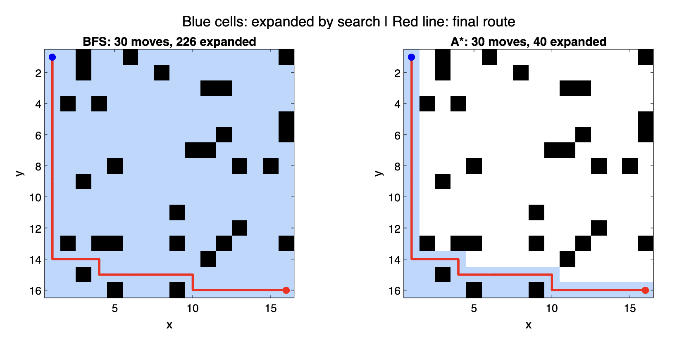

# MATLAB Grid Pathfinding

An interactive route planner for exploring how a robot can navigate an obstacle grid. Create a map, choose a start and goal, and watch the robot follow a route cell by cell.

## Motivation and goal

A route drawn on a map tells you where to go, but it hides the work the planner did to find it. This project makes both visible. The goal was to build a complete planning workflow, from generating an obstacle map to animating a route, and to see how the choice of search algorithm affects the work needed to find a shortest path.

## What the project achieved

- Built a MATLAB GUI for generating obstacle maps, validating endpoints, and finding shortest routes with breadth-first search (BFS).
- Added routes through random reachable checkpoints, route selection, CSV export, and animation. A checkpoint can produce a detour or repeat the original route.
- Demonstrated an unreachable goal on a map where obstacles trapped the start.
- Compared BFS and A* on the same fixed map with the same four-direction movement rules.



| Search | Route length | Cells expanded |
| --- | ---: | ---: |
| BFS | 30 moves | 226 |
| A* | 30 moves | 40 |

Both searches returned the same shortest route in this example. The red line shows the final route and the blue shading shows the cells each search processed. A* uses Manhattan distance and breaks ties by favoring cells closer to the goal.

## How to run it

Clone or download the repository and open it in MATLAB. The project was tested with MATLAB R2025a. From the repository root, run these commands in the MATLAB Command Window.

```matlab
cd code
PathTestWithAlternates
```

1. Set the grid size and obstacle density, then click **Generate Map**.
2. Enter the start and goal as `x,y` coordinates on free cells, then click **Plot Start / End**.
3. Click **Find Path** to draw the shortest route.
4. To try a checkpoint route, click **Generate Alternative Path**. Use **Select Path** to choose a route and click **Start Simulation** to animate it. The latest checkpoint route is saved as `alternativePath.csv` in MATLAB’s current folder.

To reproduce the BFS and A* figure, run `compareSearches` from the same `code/` folder. It opens a separate figure and prints both search counts in the Command Window.

## Example runs

| What to look for | Screenshots |
| --- | --- |
| A generated 16×16 map, followed by endpoint selection and the shortest route | [Map](docs/screenshots/occupancy-grid.png) · [Endpoints](docs/screenshots/start-end-markers.png) · [BFS route](docs/screenshots/bfs-shortest-path.png) |
| The first checkpoint attempt repeated the 30-move route. The second produced a distinct 34-move route. | [Repeated route](docs/screenshots/path-2-duplicate.png) · [Distinct route](docs/screenshots/path-3-alternative.png) |
| The simulation follows horizontal and vertical segments and makes right-angle turns. | [On a segment](docs/screenshots/simulation-on-horizontal-segment.png) · [At a turn](docs/screenshots/simulation-at-turn.png) |
| One map at density 0.1 had a 30-move route. On the sampled 0.3 map, obstacles trapped the start. | [0.1 route](docs/screenshots/density-0p1-route.png) · [0.3 map](docs/screenshots/density-0p3-map.png) · [No path dialog](docs/screenshots/density-0p3-no-path-dialog.png) |
| The GUI route used as the baseline for the fixed-map comparison | [BFS baseline](docs/screenshots/bfs-baseline.png) |
